<p align="center">
  
</p>

<p align="center">
  <a href="https://github.com/alexpandiyan1914/dev-view/actions/workflows/ci.yml"></a>
  <!-- After the first npm release, add: <a href="https://www.npmjs.com/package/dev-view"></a> -->
  <a href="LICENSE"></a>
  
  <a href="CONTRIBUTING.md"></a>
</p>

<p align="center">
  <b>Find the problems hiding in your project, understand why they matter, and know exactly how to fix them.</b>
</p>

<p align="center">
  
</p>

## Why Dev View?

Most tools tell you **that** something is wrong. Dev View also tells you **why it matters** and **what to do about it**, in plain language.

- **Every problem comes with a reason and a fix.** Each warning and error carries a short "why" and a concrete suggestion. A rule that cannot explain itself does not ship.
- **It checks what really breaks projects.** Committed `.env` files and private keys, `node_modules` or `dist` tracked by Git, huge files, missing `.gitignore`, no lockfile, placeholder test scripts.
- **One engine, two modes.** Analyze a folder on your machine, or any public GitHub repository by its URL. Both run the same checks.
- **Safe by design.** It only reads. It never changes your files and never runs your project's code. Local mode uses no network, and nothing is ever uploaded.
- **Honest scoring.** A simple, documented score, deliberately kept secondary to the findings.

## Quick start

You need [Node.js](https://nodejs.org) 22.12 or newer and [Git](https://git-scm.com).

```bash
# analyze the project in the current folder
npx dev-view local

# analyze another folder
npx dev-view local ./my-project

# analyze a public repository without cloning it yourself
npx dev-view remote https://github.com/user/project
```

By default the report is short. Add `--verbose` (or `-v`) to see every check that ran:

```bash
npx dev-view local -v
```

### Commands

| Command | What it does |
| --- | --- |
| `dev-view local [path]` | Analyze a folder (default: the current one). |
| `dev-view remote <url>` | Analyze a public repository by its `https://` URL. |
| `dev-view rules` | List every check Dev View can run. |
| `dev-view --help` | Show help. `--version` shows the version. |

## What it checks

**All projects**

| Check | Severity | Why it matters |
| --- | --- | --- |
| README present | warning | Nobody can use what they cannot understand. |
| LICENSE present | warning | Without a license, others may not legally use your code. |
| Git repository and `.gitignore` | warning | History, backups, and keeping junk out of commits. |
| `.env` files tracked by Git | **error** | Secrets in a repository stay in its history. `.env.example` is fine. |
| `.env` files not covered by `.gitignore` | warning | One `git add .` away from a leak. |
| Private keys tracked by Git | **error** | Detected by file content, so public certificates are not flagged. |
| `node_modules`, virtual environments tracked | **error** | They can be reinstalled and bloat the repository. |
| `dist`, `build`, `target`, `.next`, `coverage`, `__pycache__` tracked | warning | Generated files create noisy changes. |
| Large tracked files (50 MiB and up) | warning, **error** at 100 MiB | GitHub warns at 50 MiB and refuses 100 MiB. |

**Node.js projects**

| Check | Severity |
| --- | --- |
| `package.json` is valid JSON | **error** |
| name, version, description and license are set (skipped for `"private": true`) | warning |
| A real `test` script (not npm's placeholder) | warning |
| Test files exist | warning |
| One lockfile, committed to Git | warning |
| Publishable packages limit their files (`files` or `.npmignore`) | warning |
| No package listed in both `dependencies` and `devDependencies` | warning |
| `engines.node` declared | info |

**Python projects**

| Check | Severity |
| --- | --- |
| `requirements.txt` is not empty and its packages have versions | warning |
| Test files exist | warning |
| Python version declared (`.python-version`, `requires-python`, ...) | info |

Run `dev-view rules` to see the same list from the tool itself.

## How the score works

```text
start at 100
subtract 10 for every error
subtract 3 for every warning
never go below 0
```

Passes and info lines never change the score. It counts problems, not files, so a large project and a small one with the same problems get the same score. The report prints the arithmetic under the score, so there is never a mystery.

## What a finding looks like

```text
01 ✖ .env is tracked by Git
   │ WHY
   │ Anyone who can read the repository can read these values. Deleting the file later does
   │ not help, because it stays in Git history.
   │
   │ SUGGESTION
   │ Run 'git rm --cached .env' and add it to .gitignore. Then rotate (replace) every secret
   │ inside it, because the old values may already be exposed.
```

## Safety and privacy

- **Read-only.** Dev View never writes to, deletes, or changes anything in the project it analyzes.
- **Your code is never executed.** It reads files and asks Git read-only questions (`git ls-files`, `git check-ignore`). It does not run your scripts, tests, or build.
- **No telemetry, no uploads.** Local mode makes no network requests at all.
- **Remote mode is careful.** Only plain `https://` addresses are accepted (no SSH, `file://`, or credentials in the URL). It makes a shallow, single-snapshot clone into a temporary folder, never asks for passwords or opens login windows, skips Git LFS downloads, and always deletes the temporary copy, even when you press Ctrl+C.

See [SECURITY.md](SECURITY.md) to report a vulnerability.

## Limitations

Dev View is young, and it is honest about what it does not do yet.

- It inspects the **current snapshot**, not Git history. A secret that was committed and later deleted will not be found. For that, use a dedicated tool such as [gitleaks](https://github.com/gitleaks/gitleaks).
- Ecosystem checks look at the **project root** only. Monorepos with several packages are not analyzed package by package.
- Remote mode supports **public** repositories only.
- Checks are heuristics: they are tuned to avoid false alarms, but a few judgement calls (for example a `dist` folder committed on purpose) are possible. Those findings say so.
- It is not a vulnerability scanner or a code linter. Use `npm audit`, `pip-audit`, ESLint, or Ruff for that.

## Roadmap

- `dev-view ci`: exit codes and a compact format for pipelines
- JSON output for other tools
- An optional config file to tune or disable rules
- More ecosystems, starting with Java and Spring Boot

## Run from source

```bash
git clone https://github.com/alexpandiyan1914/dev-view.git
cd dev-view
npm install
npm run build
node dist/cli.js local .
```

## Development

| Script | What it does |
| --- | --- |
| `npm run dev -- local .` | Run straight from the TypeScript source. |
| `npm test` | Run the test suite (Vitest). |
| `npm run typecheck` | Type-check everything. |
| `npm run build` | Build `dist/cli.js`. |
| `npm run check:package` | Inspect what would be published. |

How it is built:

```text
  folder or URL
       │
   input layer ──────────►  ProjectContext   (files, Git-tracked files, ignored files)
                                  │
   detectors  ───────────►  Node.js? Python? frameworks?
                                  │
   rule engine ──────────►  findings  (problem + severity + why + suggestion)
                                  │
   scorer and reporter ──►  the report you read
```

Local and remote mode only differ in the first box. Everything after it is shared, which is why adding a rule or an ecosystem means touching one place.

```text
src/
  cli.ts          commands and options
  input/          local folders, Git, remote cloning and URL validation
  detectors/      which ecosystems and frameworks are present
  rules/          the checks: universal/, node/, python/, and the registry
  core/           scanner, rule engine, scorer, reporter
tests/            unit tests, fixture projects, and end-to-end CLI tests
```

Want to add a check? [CONTRIBUTING.md](CONTRIBUTING.md) walks through it step by step.

## Contributing

Bug reports, ideas, and pull requests are welcome. Please read [CONTRIBUTING.md](CONTRIBUTING.md) first.

## License

[MIT](LICENSE)
